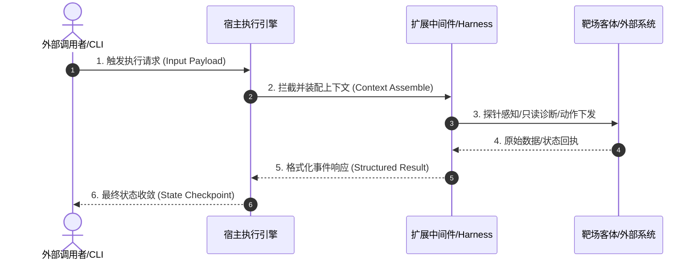

# [概念/机制名称]: 深度研学与底层架构透析

> 💡 **10秒心智锚点 (Mental Model Anchor)**：  
> - **一句话技术内核**：[用资深工程师的话一针见血点破底层机制，绝不堆砌抽象黑话]  
> - **主客体拓扑**：宿主引擎 `[类名/进程]` ──(调度/挂载)──► 中间件 `[机制/工具]` ──(作用于)──► 演示靶场 `[客体]`  
> - **实操验证线索**：沙盒入口 `[相对路径]` ➔ 终端命令 `[运行指令]` ➔ 预期观察 `[核心日志/验收事件]`  

---

## 1. 动机穿透：为什么需要这个机制？ (Why It Exists)

### 1.1 历史工程痛点 (The Ugly Truth)
在没有引入该机制之前，工程实现遇到了什么恶心痛点？（如状态内存丢失导致长流程崩溃、上下文线性暴增导致 Token 爆仓、工具调用死循环等）。

### 1.2 切斯特顿栅栏与架构取舍 (Architecture Trade-offs)
作者为什么选择这种设计方案，而不是搞别的方式？
- **方案 A（常规简单粗暴做法）**：缺点与致命瓶颈。
- **方案 B（当前框架做法）**：它牺牲了什么（复杂度/学习成本），换取了什么核心收益（可靠性/扩展性）？

### 1.3 直觉心智模型 (Intuitive Analogy)
如果用日常工程或生活事物打比方，它最像什么？（如“机场塔台调度与航班握手”、“数据库 WAL 预写日志与断电恢复”）。

---

## 2. 架构拓扑与运行时生命周期 (Runtime Lifecycle & State Machine)



### 关键生命周期阶段拆解：
1. **启动与依赖注入 (Bootstrap & Injection)**：...
2. **事件循环与中间件流转 (Event Loop & Interception)**：...
3. **状态收敛与断点持久化 (Convergence & Checkpointing)**：...

---

## 3. 核心机制源码与配置拆解 (Code Anchoring & Open-Source Grounding)

> 🔗 **沙盒代码坐标**：[`../../02-labs/milestones/...`](../../02-labs/) 或 [`../../02-labs/open-source/...`](../../02-labs/)  
> ⚠️ **去噪音铁律**：本节严格聚焦于框架的接口定义、中间件装配与状态变更，**严禁花篇幅解释演示靶场的业务算法**！

### 3.1 核心配置/定义入口
```typescript
// 聚焦核心接口定义与关键参数
```

### 3.2 执行流逐行深潜
- **入口函数**：...
- **分支与状态转移**：...
- **异常捕获与熔断**：...

### 3.3 权威开源工程对照 (Real Open-Source Mapping)
- **对应开源仓库与文件**：`[仓库名/路径/文件#Lxx-Lxx]`
- **开源成熟实现比对**：开源工业库在处理同类场景时，采用了什么设计？（对比我们手撕的切片与开源基准的差距与考量）。

---

## 4. [按需解锁] 工业级真实生产案例与生产防线武装 (Real-World Production Scenarios · On-Demand)

> 💡 **节律控制铁律**：初学本章概念文档时，**请先聚焦核心功能，本节默认不展开**！避免沉重的生产防线反客为主、冲淡核心心智。当学习者确认核心吃透、主动提出需要上生产级落地时，再将本节补全武装。
> 🚨 **彻底淘汰“查天气/猫粮客服/假Todo”等悬浮的代入式玩具案例 (Toy Cases)！** 本节一旦解锁，必须记录真实工业复杂场景。

### 4.1 真实业务痛点场景 (Production Context)
- **业务场景**：[例如：跨境电商分布式长流程履约补偿 (Saga)、企业级多租户文档 RAG 上下文物理隔离、千万级长流式对话断电断网恢复]
- **为何玩具方案必死**：[说明为什么简单的内存变量或无状态方案在生产中会导致数据污染/资损/雪崩]

### 4.2 生产级架构装配与代码落地 (Production Implementation · 核心之外五大要素武装)
- **挂载的真实外部组件**：[如：真实 PostgreSQL 状态 Checkpointer、Redis 幂等分布式锁、SSE 协议流式网关]
- **核心之外五大生产要素落地核对**：
  - [ ] **稳定性与容错**：[超时退避重试、降级兜底、熔断机制]
  - [ ] **安全性与沙箱隔离**：[敏感数据脱敏、提示词防注入、多租户上下文隔离]
  - [ ] **并发与资源管控**：[分布式防重幂等锁、Token预算熔断与滑动窗口压缩]
  - [ ] **持久化与事务一致性**：[真实DB Checkpoint、WAL日志、事务补偿 Saga]
  - [ ] **全链路可观测性**：[结构化 JSON 日志、OpenTelemetry Trace ID、指标度量]
- **核心生产装配与防御性代码**：
```typescript
// 真实生产环境下的全要素装配与流式拦截
```

### 4.3 极限破坏性抗压与自愈验证 (Chaos & Resilience Test)
- **注入的致命异常**：[主动注入：依赖服务 Crash / 网络延迟 5000ms 超时 / Token 突发溢出截断 / 并发写冲突]
- **框架韧性与自愈表现**：[展示框架如何自动重试退避、状态事务回滚、降级熔断]

---

## 5. 终端物理现场与实操指南 (Hands-on Verification)

### 5.1 运行命令
```bash
# 在沙盒工程目录下执行极简验证
npm run demo:01
# 或执行真实生产级案例
npm run demo:03
# 或执行极端抗压容错验证
npm run demo:04
```

### 5.2 真实控制台输出与物理证据深潜
```text
[真实终端日志截图/文本，标注全链路 Trace ID、生命周期事件耗时、事务回滚或状态恢复证据]
```

---

## 6. 避坑指南：Naive vs Production 对比 (Gotchas & Best Practices)

| 场景维度 | Naive 粗暴做法 (Demo 玩具代码) | Production 工业级做法 (企业生产防线) |
|---|---|---|
| **并发与锁竞争** | 内存变量直接累加，并发必崩 | 分布式锁 / 事务 CAS / 乐观锁版本号 |
| **状态持久化** | 进程挂掉状态全丢 | 挂载持久化 Checkpointer + WAL 机制 |
| **异常与重试** | 抛出未捕获异常导致进程退出 | 指数退避重试 + 熔断降级 + 死信队列 |
| **鉴权与隔离** | 本地明文凭据，无沙箱防护 | 最小权限原则 + 进程隔离/容器沙盒 |

---

## 7. 全量技术事实核对表 (Zero-Loss Fact Sheet)

> 严格对账官方课件与源码，100% 捕获底层细节，拒绝信息折损：

| 配置项/参数名 | 类型 | 默认值 | 合法取值/约束 | 作用与底层原理 | 官方文档/源码对应坐标 |
|---|---|---|---|---|---|
| `timeout_ms` | `number` | `30000` | `> 0` | 超过该阈值触发中断取消 | `core/engine.ts#L45` |
| `max_iterations` | `number` | `10` | `1~50` | 防止 Agent 循环死锁的熔断门限 | `config/limits.ts#L12` |

---

## 7. 本节视觉手账小结卡 (Style 2: Swiss Grid Sketchnote)


